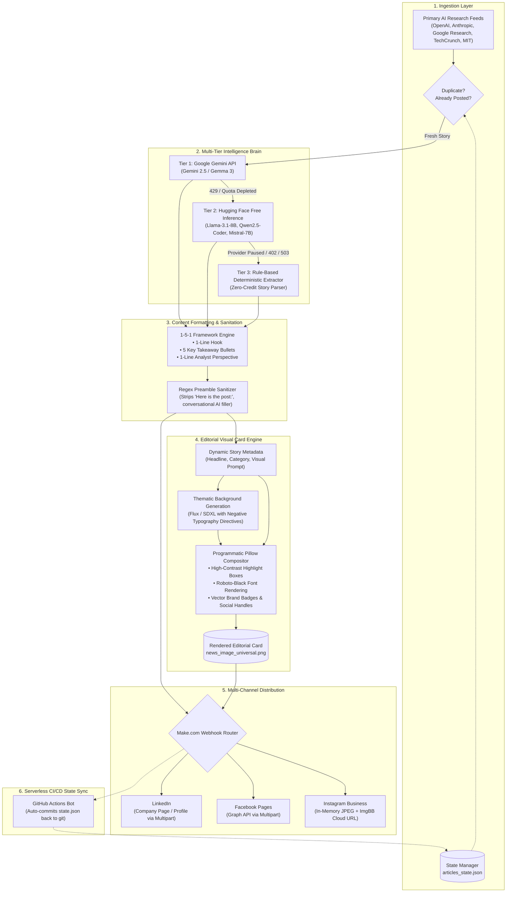

# GenAI Pro: Autonomous Multi-Channel AI News & Intelligence Agent

[](https://www.python.org/downloads/)
[](https://opensource.org/licenses/MIT)
[](https://github.com/features/actions)
[](#fault-tolerant-architecture)

An autonomous, production-grade Agentic AI system that continuously monitors primary Generative AI research feeds, curates high-signal developments, synthesizes editorial visual card assets, and orchestrates multi-platform publishing across LinkedIn, Facebook, and Instagram.

Built from the ground up to operate **24/7 with zero human intervention and €0/month cloud infrastructure costs**, featuring a self-healing 3-tier fallback engine that withstands API rate limits and quota depletion.

---

## Architecture Overview



---

## Key Engineering Innovations

### 1. Self-Healing 3-Tier Fallback Engine
API quotas fluctuate and free tiers experience rate limits. Most agents crash when receiving an HTTP `429 Too Many Requests` or `Prepayment Credits Depleted`. GenAI Pro implements a deterministic multi-stage fallback:
1. **Tier 1 (Primary):** Google Gemini Developer API (`gemini-2.5-flash` / `gemma-3-27b-it`).
2. **Tier 2 (Serverless LLM Fallback):** Hugging Face Serverless Inference API running open-weights models (`meta-llama/Llama-3.1-8B-Instruct`, `Qwen/Qwen2.5-Coder-32B-Instruct`, `mistralai/Mistral-7B-Instruct-v0.3`).
3. **Tier 3 (Zero-Credit Dynamic Extraction):** If cloud inference is entirely unavailable, the engine uses heuristic story analysis to dynamically extract the headline, category, takeaways, and image prompt from the news feed metadata. **The agent never crashes, never halts, and never outputs hardcoded duplicates.**

### 2. High-Dwell "1-5-1" Editorial Framework
Generic paragraph summaries suffer from low read-through rates and high algorithmic bounce. Every LinkedIn draft adheres to a crisp structural framework:
* **Line 1 (Hook):** A concise, scroll-stopping declarative statement of what changed.
* **Lines 2–6 (5 Bullet Points):** Exactly 5 technical, data-backed takeaways starting with `•` (benchmarks, architecture specs, deployment dates, API availability, limitations).
* **Line 7 (Analyst Perspective):** A 1-sentence strategic forecast on industry impact.
* **Footer:** Clean source attribution and targeted hashtags.

### 3. Regex AI Preamble Sanitizer
LLMs frequently prepend conversational conversational artifacts (e.g., *"Here's a draft of the post:"*, *"Key developments in AI infrastructure:"*, *"Certainly! Below is the summary:"*). The built-in `clean_llm_post_text()` engine runs multi-pass regex normalization to strip conversational preambles, markdown backtick fences, and quote wrappers before dispatching to social APIs.

### 4. Hybrid Generative & Programmatic Visual Engine
Raw text-to-image models struggle with precise typography, spelling, and consistent brand geometry. GenAI Pro decouples visual composition:
* **Generative Layer:** AI backgrounds generated via Realtime Flux / SDXL with strict negative prompts (`no text, no words, no letters, no typography, no watermarks, no titles, no logos`).
* **Deterministic Layer:** Programmatic rendering via `Pillow`:
  * Dynamic headline word-wrapping and kerning with `Roboto-Black`.
  * High-contrast inverted highlight accent boxes (`#F4B41A` gold on `#143d59` deep navy).
  * Category badge stamping (`AI HARDWARE`, `RESEARCH & BENCHMARKS`, `AI AGENTS`).
  * Vector brand watermarks and social handle footers.

### 5. Multi-Payload Webhook Bridge
Platforms require divergent upload specifications:
* **LinkedIn & Facebook:** Require binary `multipart/form-data` uploads.
* **Instagram Graph API:** Strictly refuses binary payloads and demands a publicly accessible direct HTTPS image URL in `JPEG` format (converted dynamically in-memory without disk overhead, hosted via ImgBB/Dropbox).

---

## Directory Structure

```text
├── .github/workflows/
│   └── agent_cron.yml          # GitHub Actions 10-hour autonomous cron schedule
├── data/
│   └── articles_state.json     # Persistent state tracking (deduplication database)
├── drafts/                     # Local post drafts and generated visual assets
├── src/
│   ├── core/
│   │   ├── config.py           # Feed endpoints & environment bindings
│   │   ├── fetcher.py          # RSS feed ingestion & sanitization
│   │   ├── image_generator.py  # Pillow typography compositor & AI background client
│   │   ├── llm_processor.py    # 3-tier fallback engine, 1-5-1 formatting, preamble cleaner
│   │   └── state_manager.py    # Deduplication & historical state storage
│   └── publishers/
│       └── make_webhook.py     # Multi-payload dispatch bridge (multipart vs JSON)
├── tests/
│   ├── test_clean_post_text.py      # Validation suite for preamble stripper (8/8 test cases)
│   ├── test_dynamic_metadata.py     # Dynamic story-specific metadata extraction suite
│   ├── test_prepayment_fallback.py  # Zero-credit 3-tier fallback validation suite
│   └── test_carousel_generator.py   # Multi-slide visual deck testing
├── main.py                     # Primary orchestration CLI
├── requirements.txt            # Python dependencies
├── .env.template               # Environment variable configuration template
└── LICENSE                     # MIT License
```

---

## Quickstart & Installation

### Prerequisites
* Python 3.11+
* Git
* Make.com account (for multi-platform routing)

### 1. Clone the Repository
```bash
git clone https://github.com/frasheed-dev/GenAI-Pro-Agent.git
cd GenAI-Pro-Agent
```

### 2. Set Up Virtual Environment
```bash
python -m venv venv
# Windows:
.\venv\Scripts\activate
# Linux/macOS:
source venv/bin/activate

pip install --upgrade pip
pip install -r requirements.txt
```

### 3. Configure Environment Variables
Copy `.env.template` to `.env` and provide your credentials:
```bash
cp .env.template .env
```

Key variables:
```env
# Set to 'true' to publish live via webhooks; 'false' to save locally in drafts/
AUTONOMOUS_MODE=false

# Primary & Fallback LLM Credentials
GEMINI_API_KEY="your_google_ai_studio_key"
HF_TOKEN="your_huggingface_user_token"

# Distribution Router
MAKE_WEBHOOK_URL="https://hook.eu2.make.com/your_webhook_id"

# Instagram Cloud Image Host
IMAGE_HOST="imgbb"
IMGBB_API_KEY="your_imgbb_api_key"
```

---

## Usage

### Local Execution (Draft Mode)
Run the agent locally. Text and rendered cards are saved to `drafts/`:
```bash
python main.py
```

### Targeted Platform Testing
```bash
# Generate drafts for LinkedIn only:
python main.py --platform linkedin --draft true

# Force a LIVE publish to all configured channels:
python main.py --draft false
```

### Running Validation Suites
Validate fallbacks and text sanitization offline:
```bash
# Verify bot preamble stripping:
python tests/test_clean_post_text.py

# Verify zero-credit fallback engine:
python tests/test_prepayment_fallback.py

# Verify dynamic metadata extraction:
python tests/test_dynamic_metadata.py
```

---

## Autonomous GitHub Actions Deployment

The repository includes a ready-to-run GitHub Actions workflow in `.github/workflows/agent_cron.yml`.

To deploy:
1. Push this repository to your GitHub account.
2. In your GitHub repository, navigate to **Settings** → **Secrets and variables** → **Actions**.
3. Add the following repository secrets:
   * `GEMINI_API_KEY`
   * `HF_TOKEN`
   * `MAKE_WEBHOOK_URL`
   * `IMGBB_API_KEY`
4. The agent will run every 10 hours, discover fresh news, generate branded assets, publish to social channels, and automatically commit `articles_state.json` back to the repository.

---

## Roadmap & Upcoming Enhancements

- [ ] **Path A: Outbound AI Thought-Leadership Engagement Assistant:** Autonomous monitoring of posts from the top 100 voices in AI on LinkedIn. An agent evaluates new discussions and drafts 1-line analyst-grade commentary for high-visibility engagement.
- [ ] **Short-Form Video & Reels Engine:** Programmatic vertical video synthesis (9:16) using MoviePy, FFmpeg, dynamic subtitle timing (ASS), and zero-cost Edge-TTS voice synthesis.
- [ ] **B2B Newsletter Syndication:** Automatic weekly roundup generation dispatched directly to Beehiiv / Substack API endpoints.

---

## License

Distributed under the **MIT License**. See [`LICENSE`](LICENSE) for more information.

---

## Author & Contact

Developed by **[Farhan Rasheed, PhD](https://www.linkedin.com/in/frasheedf)**  
*Building Autonomous Agentic Systems & Generative AI Infrastructure.*

See the live automated output in action on LinkedIn: **[GenAI Pro Company Page](https://www.linkedin.com/company/102614443)**
